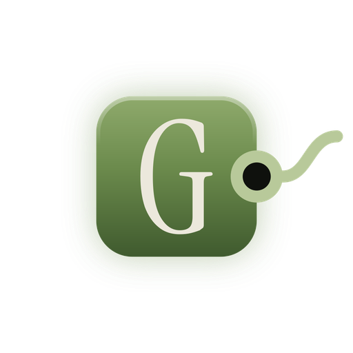
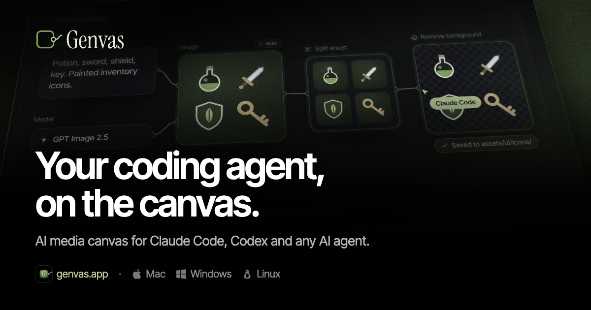
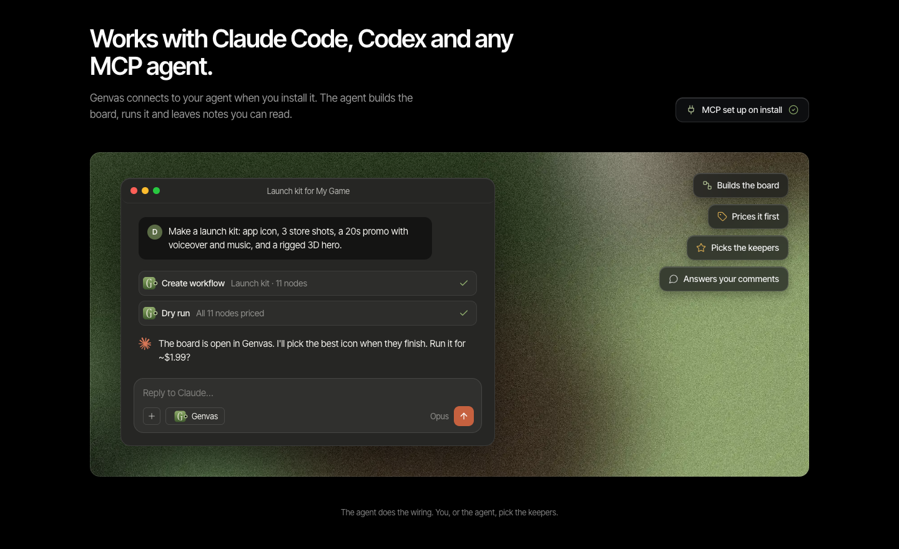
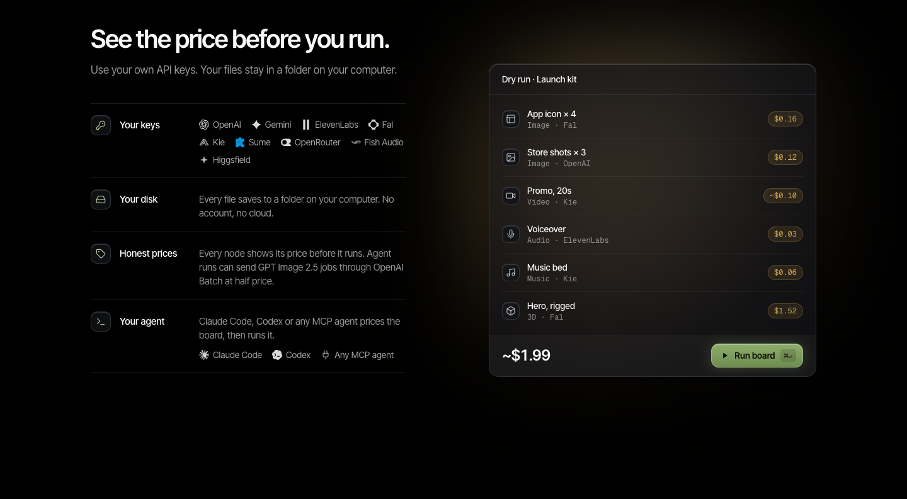
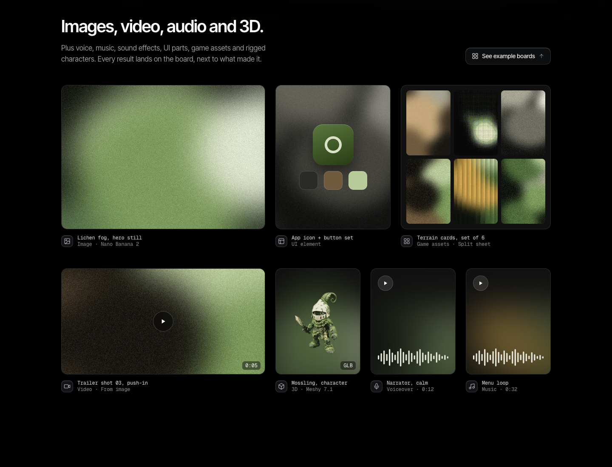

<h1 align="center">Genvas</h1>

<strong>Desktop canvas for AI images, video and audio</strong>

<a href="https://genvas.app">Website</a> · <a href="https://api.genvas.app/download/latest/mac">Download for Mac</a> · <a href="https://github.com/deeflect/genvas/issues/new?template=bug_report.yml">Report a bug</a> · <a href="https://github.com/deeflect/genvas/issues/new?template=feature_request.yml">Request a feature</a>

 

Genvas is a desktop app for people who make AI images, video, voiceovers, music and 3D models on a node canvas. It runs on Mac, Windows and Linux. A licence costs $99 once, or $79 for the first 100 buyers.

## Features

### Node canvas
Build a board of connected nodes. Every result lands on it next to what made it.

### Local MCP server
Your coding agent can build and run boards through the MCP server that Genvas ships.

### Price before you run
Dry-run pricing shows the cost of a run before it starts. Agent runs can use OpenAI Batch at half price.

### Your own API keys
Connect keys from OpenAI, Gemini, ElevenLabs, Fal, Kie, Sume, OpenRouter, Fish Audio or Higgsfield.

### Full-screen viewers
Crop, split, upscale, trim and compose in a full-screen viewer.

## Download

Genvas is in early access. Get it from [genvas.app](https://genvas.app), where payment runs through Stripe Checkout. One licence is $99, or $79 at the founder price, and covers up to three devices and one year of updates. The app keeps working after the year ends. It runs on Mac (Apple silicon), Windows 10 and 11 (x64) and Linux (.deb, x64).

## Questions

### Who pays for the AI generations?
You do, straight to the provider with your own key. Genvas adds nothing on top.

### Where does Genvas save my files?
In a folder on your computer.

### Which agents work with Genvas?
Claude Code and Codex are set up on install. Any other agent that speaks MCP can connect too.

## Feedback

Bug reports and feature requests are welcome: [open an issue](https://github.com/deeflect/genvas/issues). A useful bug report gives the app version, your system version and the steps that lead to the bug. I read every issue.

## Made by

Genvas is made by [Dee](https://deeflect.com), a one-person studio.
