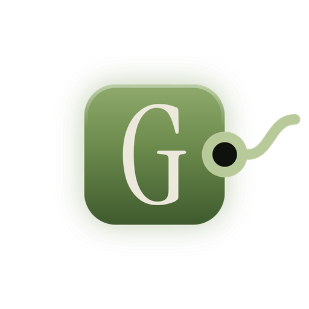
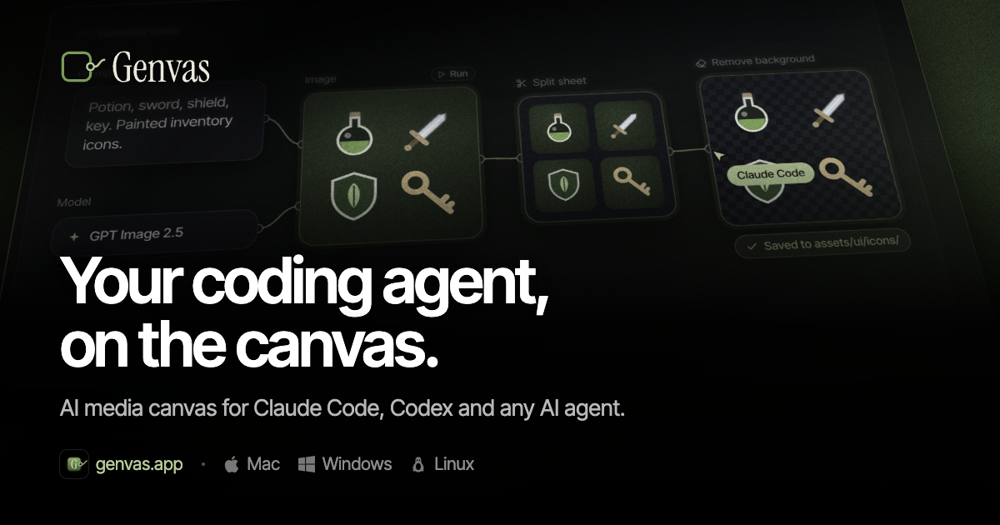
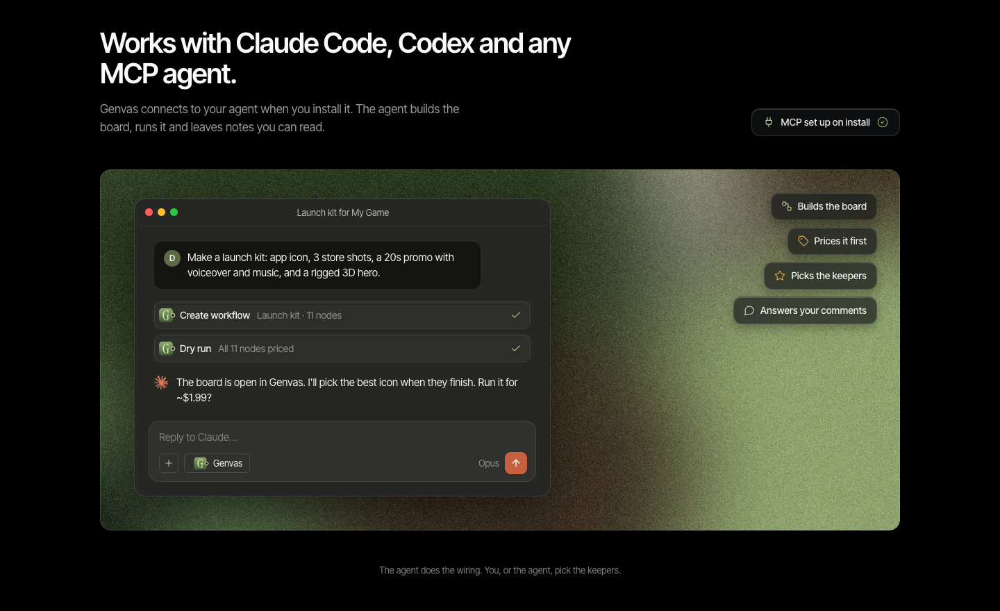
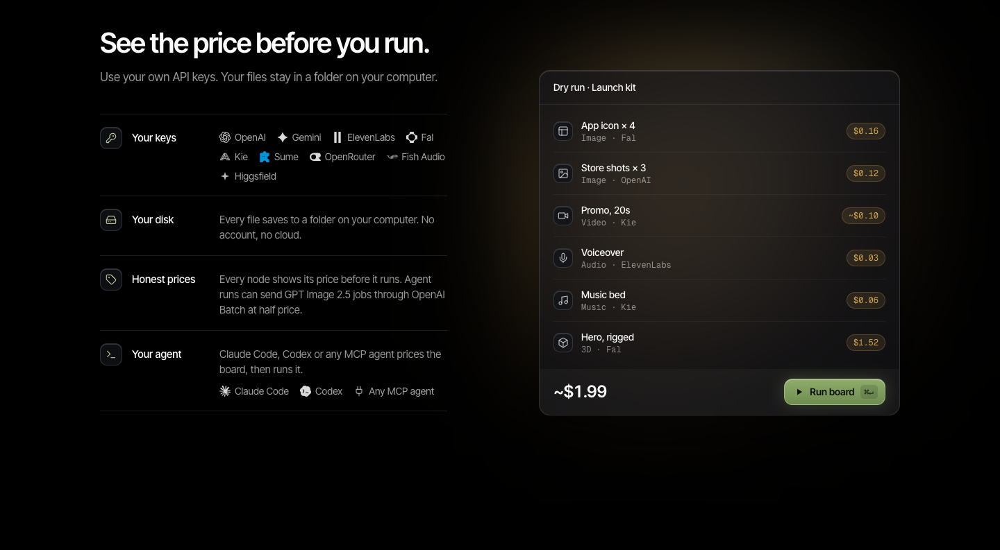
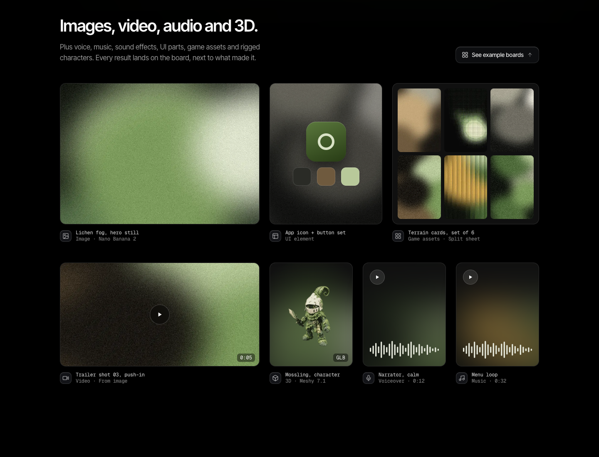

<h1 align="center">Genvas</h1>

<strong>Desktop canvas for AI images, video, audio and 3D — driven by your coding agent over MCP</strong>

<a href="https://genvas.app">Website</a> · <a href="https://github.com/deeflect/genvas/releases/latest">Download Beta (Mac / Windows / Linux)</a> · <a href="https://github.com/deeflect/genvas/issues/new?template=bug_report.yml">Report a bug</a> · <a href="https://github.com/deeflect/genvas/issues/new?template=feature_request.yml">Request a feature</a>

  

Genvas is a desktop app for people who make AI images, video, voiceovers, music and 3D models on a node canvas. It runs on Mac (Apple silicon), Windows (x64) and Linux (.deb, x64).

> **Beta & Open Source:** Genvas is **free during beta** with no licence key or subscription required. Source code is being cleaned up and will be published in this repository under **AGPL-3.0** soon.

## Download

Grab the latest signed beta installer directly from **[GitHub Releases](https://github.com/deeflect/genvas/releases/latest)**:

- **macOS (Apple silicon):** `Genvas_1.4.0_aarch64.dmg`
- **Windows (x64):** `Genvas_1.4.0_x64-setup.exe`
- **Linux (x64 .deb):** `Genvas_1.4.0_amd64.deb`

In-app auto-updates pull signed updates from GitHub Releases.

## Features

### Node canvas
Build a board of connected nodes. Every result lands on it next to what made it.

### Local MCP server
Your coding agent can build and run boards through the MCP server that Genvas ships.

### Price before you run
Dry-run pricing shows the cost of a run before it starts. Agent runs can use OpenAI Batch at half price.

### Your own API keys
Connect keys from OpenAI, Gemini, ElevenLabs, Fal, Kie, Sume, OpenRouter, Fish Audio or Higgsfield.

### Full-screen viewers
Crop, split, upscale, trim and compose in a full-screen viewer.

## Questions

### Who pays for the AI generations?
You do, straight to the provider with your own key. Genvas adds nothing on top.

### Where does Genvas save my files?
In a folder on your computer.

### Which agents work with Genvas?
Claude Code and Codex are set up on install. Any other agent that speaks MCP can connect too.

### When is the source code going public?
Soon—this repository will host the full **AGPL-3.0** source once the release cleanup finishes. Until then, signed beta binaries and issue tracking live right here.

## Feedback

Bug reports and feature requests are welcome: [open an issue](https://github.com/deeflect/genvas/issues). A useful bug report gives the app version, your system version and the steps that lead to the bug. I read every issue.

## Made by

Genvas is made by [Dmitry (Dee) Kargaev](https://www.deeflect.com) (`deeflect`).
